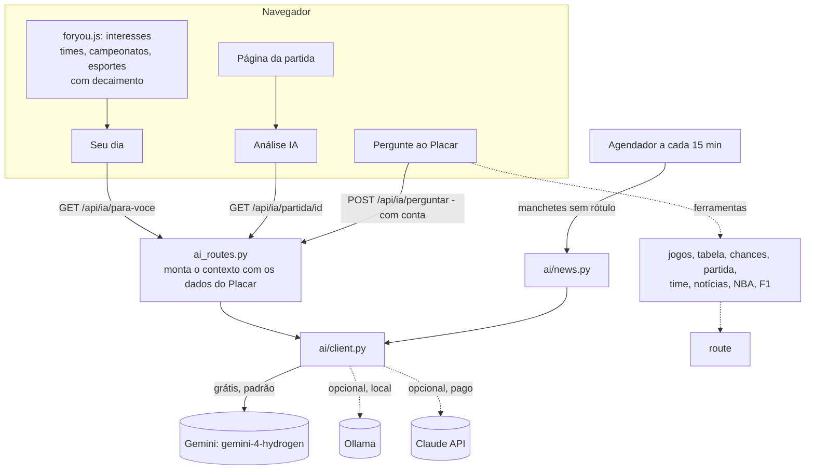

# Arquitetura do Placar

Placar é um app web de futebol, NBA e Fórmula 1 ao vivo. O backend é Python (biblioteca padrão; o SDK da
Anthropic é opcional); o frontend é JavaScript puro, sem build. A IA usa o Gemini no plano grátis (ou Claude/Ollama, configuráveis).

## Mapa do projeto

```
server.py                 ponto de entrada (python server.py [porta]) -> placar.server.main()
placar/
  config.py               caminhos (raiz, public/, data/, DATA_DIR), .env e fuso de Brasília
  server.py               HTTP, rotas /api, cache e orçamento da API Futebol, tempo real (SSE), agendador
  ai_routes.py            rotas /api/ia/*: monta o contexto com os dados do Placar e chama a camada de IA
  sources/                adaptadores de fontes; todos devolvem o formato da API Futebol
    espn.py               Brasileirão, Série B, Copa do Brasil, Libertadores, Sul-Americana; ponte com a Europa
    footballdata.py       Champions e ligas europeias (football-data.org)
    transfermarkt.py      perfil, valor de mercado, transferências e títulos
    news_rss.py           portais (ge, Folha, Estadão, Trivela, Placar, Terra, Metrópoles, Gazeta) + marcação de times
  sports/                 outros esportes
    common.py             HTTP com cache e conversões compartilhadas
    nba.py                placar, jogo (box score, chance de vitória, lances), times, jogadores, classificação
    f1.py                 calendário, sessão ao vivo, resultados, pilotos e equipes
  core/                   regras do produto, independentes de fonte
    prob.py               modelo de Poisson + simulação de Monte Carlo (chances e probabilidade de vitória)
    identity.py           um clube = um ID (ID canônico ESPN/football-data em todas as respostas)
    news_filter.py        classificação das notícias por regras (esporte, categoria, campeonatos)
    auth.py               contas, sessões, captcha, Google, e-mail, sincronização
  ai/                     camada de IA — tudo opcional
    client.py             provedor (Gemini grátis, Claude ou Ollama), limite, cache, fallback, erros
    gemini.py             Gemini pela Interactions API (padrão): JSON por schema
    ollama.py             IA local pelo Ollama (padrão): JSON por schema e ferramentas
    news.py               rótulos das notícias em lote (segundo plano)
    insights.py           análise da partida (prévia, ao vivo, resumo)
    assistant.py          "Pergunte ao Placar" (ferramentas que leem os dados do Placar)
    foryou.py             "Seu dia no futebol" a partir dos interesses
data/transmissoes.json    onde assistir no Brasil (editável)
public/                   frontend (SPA por hash)
  app.js                  roteador, telas de futebol, componentes
  pro.js · sports.js      chances/simulador/comparador · NBA e F1
  foryou.js               algoritmo "Para você" (interesses no aparelho)
  ai.js                   análise IA, "Seu dia", assistente
  account.js · extras.js · team.js · penalty.js
tests/
  smoke_test.py           sobe o servidor e confere as rotas (dados reais)
  test_ai.py              IA e classificação de notícias com cliente falso (sem rede, sem custo)
```

## Fluxo de dados

```mermaid
flowchart LR
  subgraph Fontes
    AF[API Futebol<br/>Série B, plano 100/dia]
    ESPN[ESPN<br/>futebol BR, NBA, F1 ao vivo]
    FD[football-data<br/>Europa, 10/min]
    J[Jolpica<br/>F1]
    RSS[Portais RSS]
    TM[Transfermarkt]
  end
  AF -->|cache + orçamento + IDs canônicos| R
  ESPN --> R
  FD -->|ponte ESPN: minuto, escalações| R
  J --> R
  RSS -->|marcação de times + classificação| R
  TM --> R
  R[route em placar/server.py] --> API[/api/*]
  R --> HUB[LiveHub a cada 15 s]
  HUB -->|SSE: update, gol, periodo, outros| B[Navegador]
  API --> B
  SCHED[Agendador] -->|aquece cache, rotula notícias com IA| R
```

**Identidade dos times.** Cada fonte tem seu próprio ID para o mesmo clube. `core/identity.py` troca os IDs da
API Futebol pelo ID canônico (ESPN), e o original fica em `time_id_api_futebol`. Por isso a tabela, as chances,
o ao vivo e os favoritos usam o mesmo time. Uma página de time com ID antigo é servida pela ESPN, sem gastar
o plano. No navegador, os favoritos com o mesmo nome são unidos (`getFavs`).

**Notícias.** Os portais são lidos por RSS e os times citados são marcados. Cada notícia recebe rótulos: os da IA
quando existem, senão os das regras (`core/news_filter.py`). O filtro de campeonato aceita uma notícia em dois
casos: quando ela cita o campeonato, ou quando é do clube na liga nacional dele, sem citar outro torneio. Uma
notícia de clube nunca conta para copas. Ficam fora: Série B no Brasileirão, futebol feminino e de base,
estaduais e outros esportes.

## Camada de IA



- **O algoritmo** ("Para você", em `public/foryou.js`) aprende no aparelho e ordena jogos e notícias na hora,
  sem custo. **A IA ajuda o algoritmo** de três formas:
  1. rotula as notícias (esporte, categoria, campeonatos, times) com mais precisão que as regras;
  2. escreve o "Seu dia no futebol" com os interesses que o algoritmo aprendeu;
  3. explica as partidas e responde perguntas.
- **Nada é inventado.** A IA só vê o que o Placar já tem: tabela, forma, probabilidades do modelo, lances,
  manchetes. O assistente busca os dados por ferramentas (tools) com schema estrito.
- **Respostas validadas.** Análises, rótulos e o resumo do dia usam structured outputs (JSON garantido pelo schema).
- **Custo sob controle:**
  - cache em disco por conteúdo (`.cache/ai/`);
  - teto diário (`AI_DAILY_REQUESTS`);
  - limite por IP e por conta;
  - assistente só para quem tem conta;
  - análise ao vivo refeita a cada 15 minutos de jogo ou a cada gol;
  - rótulos em lotes de 30 com esforço baixo.
- **Sem chave, nada quebra.** `ai.client.available()` fica falso, as rotas `/api/ia/*` respondem 503 e o
  frontend esconde os recursos de IA.
- **Falhas.** Recusas do modelo vão para um modelo reserva (`fallbacks: "default"`). Erros da API viram
  mensagens amigáveis e nunca derrubam a página.

## Orçamentos e limites

| Recurso | Limite | Como o Placar respeita |
|---|---|---|
| API Futebol | 100 req/dia (plano atual) | cache em disco com TTL por rota, reserva de 10%, ao vivo pela ESPN, IDs canônicos |
| football-data | 10 req/min | no máximo 9/min, aquecimento de uma liga por vez, `Busy` para o visitante não esperar |
| Jolpica (F1) | 4/s, 500/h | 1 chamada a cada 0,3 s e cache de 30 min a 7 dias |
| IA local (Ollama) | o processador do PC | uma chamada por vez, cache, lotes de 10 manchetes |
| Claude (IA, opcional) | `AI_DAILY_REQUESTS` | cache, teto diário, limite por IP e por conta |
| Visitantes | 240 req/min por IP (20/min nas rotas do Transfermarkt) | `_allow` em `server.py` |

## Testes

```
python -m unittest tests.test_ai -v      # IA e notícias, sem rede (cliente falso)
python tests/smoke_test.py               # servidor real: site, dados, NBA/F1, contas e segurança
```
